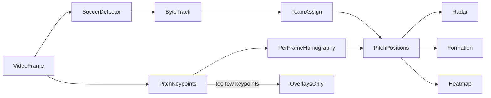

# PitchVision Roadmap

Goal: correct tactical analysis (overlays, radar, formations, heatmaps, export) on **TV broadcast footage**, where the camera pans, zooms and cuts between angles.

Phases are ordered so that each one leaves the app in a working state and ends with a concrete check. Tackle them one at a time.

Workflow: all work is committed directly to `main` and pushed to `origin/main`. No feature or backup branches.

## Current state (23 Nov 2026)

- **Load Video works** (Phase 1 done) and has been run through the real Load Video path on two real 30-second broadcast clips.
- **Detection is soccer-specific** (Phase 3 done): only players, goalkeepers and referees on the pitch are marked, each with a role, and a ball position is available in 99-100% of frames on the two test clips.
- **Automatic pitch calibration works** (Phase 4 done): per-frame pitch landmarks drive a real homography; radar and heatmap only update on calibrated frames and freeze with "No pitch view" during close-ups; hard cuts reset the tracker; the Pitch Lines debug toggle projects markings back onto the video.
- **Team colours are stable** (Phase 5 done): jersey features ignore grass, teams are fitted once on outfield players, and each track's team and role are majority-voted (no mid-clip flips on the test clips). Goalkeepers take the nearest team's side. The heatmap dropdown labels by team and hides short-lived IDs.
- **Formations and heatmaps** (Phase 6 done): each team is oriented from its own goalkeeper; a formation is shown only when enough outfield players are on screen or were seen in the last few seconds. The heatmap keeps one identity per player, at most 22 and no referees, and paints a yellow-to-red patch about 3 ft across on the green pitch. The radar keeps at most 22 player icons (11 a side). The clip is analysed first with the picture held still. Teams, roles, and one formation per team are then settled from the whole clip, marker paths are smoothed, and only then does it replay from the first frame. Playback uses a 1280-wide copy so the window can hold the file's own rate, up to 30 fps. The radar and heatmap draw a full pitch, including both penalty areas and the penalty arc. Team colours are fit only once both kits are clearly different, so a white team and a blue team are not merged.
- Export MP4 is a placeholder.

## Target pipeline



## Before you start

- [x] Put one 15-30 second broadcast clip in `data/samples/` (gitignored). Every phase is checked against it. Two clips linked from the open-source [roboflow/sports](https://github.com/roboflow/sports) repo are used (1920 x 1080, 25 fps, 30 s each); from the project root:

```bash
curl -L "https://drive.usercontent.google.com/download?id=12TqauVZ9tLAv8kWxTTBFWtgt2hNQ4_ZF&export=download&confirm=t" -o data/samples/0bfacc_0.mp4
curl -L "https://drive.usercontent.google.com/download?id=1vVwjW1dE1drIdd4ZSILfbCGPD4weoNiu&export=download&confirm=t" -o data/samples/121364_0.mp4
```

- [x] Keep several GB of disk free; Phase 4 downloads another 140 MB of model weights.
- [ ] Add a clip from a different source (another league, broadcaster or camera style). The two test clips come from the same collection the detection models were trained on, so results on them are probably better than on unseen footage.

## Phase 1 - Make Load Video work (done, 17 Nov 2026)

Root cause, in the old [src/vision/detector.py](../src/vision/detector.py):

```python
self.tracker: sv.ByteTrack = sv.ByteTrack()   # removed from supervision 0.31
```

- [x] Commit the uncommitted local wiring changes on `main`, so they are preserved in history before the merge.
- [x] Merge `origin/main` into `main`. The local changes and the GitHub commit were two attempts at the same wiring fix; conflicts were resolved as follows:
  - GitHub side for `src/core/pipeline_worker.py`, `src/ui/main_window.py`, `src/ui/radar_widget.py`, `src/ui/video_canvas.py`, `src/analytics/formation_engine.py` (tracker fix, start-up error dialog, image-buffer fix).
  - Local side for `.gitignore` (superset).
  - Kept local-only `README.md`, `src/__main__.py` and `MODEL_PATH = "yolov8x.pt"`.
  - Dropped the local "re-fit team colours every 300 frames" logic; it could swap Team A and Team B mid-video because labels are assigned by cluster size.
- [x] `pip install -r requirements.txt` to pick up `trackers`.
- [x] Fix the stale project path, `MODEL_PATH` row and tracker details in `README.md`.
- [x] Headless check through the real Load Video path on a synthetic clip: 45 of 45 frames, no errors.
- [x] Confirm on a real broadcast clip: player markers on the video, dots on the radar and a heatmap building (checked on both test clips during Phase 3). Positions are still wrong at this point; that is Phase 4.

## Phase 2 - Speed and two small bugs (done, 17 Nov 2026)

- [x] Run YOLO on the Apple GPU in `src/vision/detector.py`. The device is chosen automatically (Apple GPU, then CUDA, then CPU) and can be overridden with `DEVICE` in `src/config.py`. If GPU inference fails, the detector falls back to CPU.
- [x] Remove the fixed per-frame sleep in the worker; a frame is only held back if the previous one was shown less than one frame interval ago.
- [x] Throttle the Matplotlib heatmap redraw to at most once every `HEATMAP_REDRAW_INTERVAL_S` (0.5 s), with an immediate redraw on player selection and at the end of the video.
- [x] Fix the heatmap being upside down relative to the radar; both now draw y = 0 at the top.
- [x] Show the worker's `progress` signal as a progress bar in the status bar.

Measured on an Apple M3 with a synthetic 1278 x 568 clip containing 12 people (not real match footage):

| | Before | After |
|---|---|---|
| End-to-end frame rate | 3.2 fps | 8.2 fps |
| YOLOv8x inference per frame | 190 ms (CPU) | 76 ms (Apple GPU, identical detections) |
| Fixed sleep per frame | 40 ms | 0 ms when the pipeline is slower than the video |
| Heatmap redraws | every frame (about 10 ms each) | at most 2 per second |

Remaining per-frame cost is dominated by inference (76 ms) and team classification (54 ms for 10 players). Team classification is addressed in Phase 5. Real time (25-30 fps) is not reached; if it is still out of reach after Phase 4, add a "process first, then play back" mode rather than chasing speed.

## Phase 3 - Soccer-specific detection (done, 17 Nov 2026)

Problem: the generic COCO model detects every person (crowd, coaches) and rarely finds the ball.

- [x] Evaluate and adopt a soccer-trained detector with classes ball, goalkeeper, player and referee: the pretrained weights published with [roboflow/sports](https://github.com/roboflow/sports) (`football-player-detection.pt`, `football-ball-detection.pt`). The weights are downloaded by each user (see the README) and are not stored in this repository; check the licence terms before redistributing them.
- [x] Add a `role` field (`player`, `goalkeeper`, `referee`) to `PlayerState` in `src/core/packet.py`, filled by the detector. Referees are coloured from the model rather than by colour guessing; goalkeepers are shown as "GK" with no team until Phase 5.
- [x] Find the ball with the dedicated ball model. The ball is only a few pixels wide, so the model searches a 320 x 192 window at full resolution around the ball's last position, and the whole frame at high resolution (at most every 5 frames) when the ball is lost.
- [x] Keep `BallTracker` interpolation; ignore detections further than 5% of the frame diagonal per frame from the ball's last position (the largest real movement measured was 2%).
- [x] Store weights in `models/weights/` and resolve model paths relative to the project root rather than the current directory. If the soccer weights are missing the app falls back to a generic model and says so in the status bar.

Measured on the two test clips (1920 x 1080, 25 fps, 750 frames each; values are clip 1 / clip 2) on an Apple M3:

| | Generic `yolov8x.pt` (before) | Soccer models (after) |
|---|---|---|
| People marked per frame | 28.4 / 21.0, including bench staff and stewards | 21.6 / 21.4, on-pitch only |
| of which referees | not identified | 2.7 / 1.6 |
| of which goalkeepers | not identified | 0.3 / 0.8 |
| Frames where the ball is detected | 8% / 4% | 94% / 92% |
| Frames with a ball position, including filled gaps | 62% / 13% (first 150 frames only) | 99% / 100% |
| Detection cost per frame | about 88 ms | about 128 ms (people 83, ball window 31, whole-frame ball search averaging 10-17) |
| End-to-end frame rate in the app | 7.7 / 7.4 fps (first 150 frames) | 6.1 / 5.6 fps (first 300 frames) |

The "before" people and ball-detection figures come from sampling every tenth frame; the "after" figures are from every frame through the real Load Video path. Ground truth was checked by eye on screenshots and on 12 sampled ball positions (all on the ball), not against labelled data.

Findings to carry forward:

- Without an explicit image size the soccer model runs at its training size of 1280, which took 283 ms per frame instead of 83 ms for about one more person per frame. `DETECTION_IMGSZ` is therefore fixed at 640.
- Frame rate over full 30-second runs varied between 3 and 6 fps for both the old and the new detector while the machine was under memory pressure (8 GB of RAM, swap nearly full). The pipeline on its own held about 160 ms per frame for all 750 frames, so the dips are not explained by the detection code, but their cause was not pinned down.
- Team colours are wrong on both clips (see Phase 5).
- Roles are read frame by frame, so a track's role can flip when the model is unsure (for example between goalkeeper and player). How often this happens was not measured; Phase 5 should settle the role per track.

## Phase 4 - Automatic pitch calibration (done, 23 Nov 2026)

This is the core of broadcast support. Positions previously came from a placeholder in `src/core/pipeline_worker.py`:

```python
self._homography.set_default_transform(w, h)   # stretches the frame onto the pitch
```

- [x] Add `src/vision/pitch_keypoints.py`: detect pitch landmarks on each frame and keep the confident ones (`football-pitch-detection.pt` from the same repo; 32 landmarks).
- [x] Add the landmark positions in metres to `src/config.py`, scaled to this app's 105 x 68 pitch (the Roboflow table uses 120 x 70).
- [x] On each frame with 4 or more keypoints, call the existing `HomographyTransformer.set_transform(src, dst)`.
- [x] Remove the default-transform fallback. With no calibration, leave `pitch_xy` empty; radar, heatmap and formation code already skip empty positions.
- [x] Close-ups, replays and cuts: when too few keypoints are found, show video overlays only, pause radar and heatmap accumulation, and show "No pitch view" in the status bar. Detect hard cuts (histogram correlation) and reset the tracker, since IDs do not carry across a cut.
- [x] Smooth positions across frames to stop radar jitter (`POSITION_SMOOTHING_ALPHA`).
- [x] Add a debug toggle ("Pitch Lines") that draws the projected pitch lines back onto the video using `pitch_to_pixel`.

**Done when:** with the debug toggle on, the projected lines sit on the real pitch lines while the camera pans, and the radar freezes cleanly during close-ups.

## Phase 5 - Stable teams and player identity (done, 23 Nov 2026)

Found in Phase 3: on both test clips nearly every player was put in Team A (for example 14.4 in A and 2.6 in B per frame on a red-versus-green match). At broadcast size a jersey crop is only about 20 x 15 pixels and includes grass around the shoulders, so the "dominant colour" came out grass-green for almost every player and the clusters did not separate the kits.

- [x] Fix the jersey colour feature in `src/vision/team_classifier.py` so it measures the shirt rather than the grass (tight torso crop + ignore grass-coloured pixels). Both test clips now split roughly evenly (~9.7/10.3 and ~9.2/9.6 outfield players per frame).
- [x] Settle each track's role (player, goalkeeper, referee) by majority vote rather than taking it frame by frame.
- [x] Fit team colours once, on outfield players only, and cache the team per track ID with a majority vote instead of re-clustering every player on every frame (`src/vision/team_classifier.py`). Settled tracks skip further colour extraction.
- [x] Assign goalkeepers to the team whose players are nearest.
- [x] Heatmap dropdown: label entries with their team and remove IDs that were only seen briefly (`HEATMAP_MIN_TRACK_FRAMES`).

Known limit: an ID is a tracker number, not a shirt number, and a player gets a new ID after leaving the frame. Shirt-number recognition is a stretch goal outside this roadmap.

**Done when:** team colours do not flip during the clip and the dropdown is not flooded with short-lived IDs.

## Phase 6 - Correct formations and heatmaps (done, 23 Nov 2026)

- [x] Fix the attacking direction per team in `src/analytics/formation_engine.py`. It used to assume both teams defend the same goal (`argmin` of x). Each team is now oriented from its own goalkeeper.
- [x] Use the goalkeeper role when the detector provides one. If it does not, the player nearest either goal line is the fallback and is not counted as an outfield line.
- [x] Only report a formation when at least `FORMATION_MIN_OUTFIELD` outfield players are available, and smooth the label over the last few seconds; otherwise show a dash.
- [x] Players who leave the frame keep their last pitch position for `OFFSCREEN_HOLD_S` (hollow dots on the radar) so a formation is not built only from whoever the camera currently shows. They are not invented if never seen, and a cut drops them. Heatmaps do not keep counting them.
- [x] Accumulate heatmaps only on calibrated frames. Scale each cell by the full clip length (`frames there / total frames`) with a fixed colour range, so a short pause does not look like the whole game. Add a team heatmap option (`Team A (all)` / `Team B (all)`).
- [x] Play the video near its own frame rate, up to 30 fps. The three models cannot all run that fast, so the clip is analysed first (player tracking every `PLAYER_STRIDE` frames, pitch and ball less often) and then replayed at full speed from the saved result. The models are warmed up once. The radar is capped at 22 player icons, and both the radar and the heatmap draw the penalty areas and the penalty arc.

**Done when:** the formation label is steady during wide shots and blank otherwise.

## Phase 7 - Export, polish, tests

- [ ] Wire the Export MP4 button to the existing, unused `VideoExporter` in `src/core/video_io.py`; add heatmap PNG export to `data/exports/`.
- [ ] Draw an actual ball trail (the checkbox currently only toggles a marker).
- [ ] Add `pytest` tests for the pure logic (homography, formation engine, heatmap engine, ball tracker) and a headless smoke-test script.
- [ ] Write `docs/ARCHITECTURE.md` and update the README's limits section.

**Done when:** an annotated MP4 exports and plays, and the tests pass.
