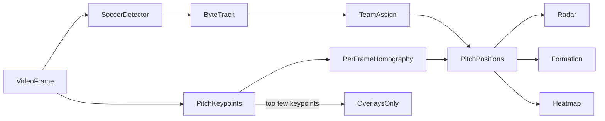

# PitchVision Roadmap

Goal: correct tactical analysis (overlays, radar, formations, heatmaps, export) on **TV broadcast footage**, where the camera pans, zooms and cuts between angles.

Phases are ordered so that each one leaves the app in a working state and ends with a concrete check. Tackle them one at a time.

Workflow: all work is committed directly to `main` and pushed to `origin/main`. No feature or backup branches.

## Current state (17 Nov 2026)

- **Load Video works** (Phase 1 done). The tracker now comes from the `trackers` package, because `sv.ByteTrack` no longer exists in supervision 0.31.
- Checked headlessly on a synthetic clip only, not yet on real match footage: detection, tracking, team colours, radar, formation string and heatmaps all produce output with no errors.
- **Speed is about 8 frames per second** on an Apple M3 after Phase 2 (GPU inference, no fixed sleep, throttled heatmap), up from about 3.
- Pitch positions are not real. The video frame is simply stretched onto the pitch rectangle, so radar, formations and heatmaps are not meaningful on broadcast footage yet.
- Export MP4 is a placeholder.

## Target pipeline



## Before you start

- [ ] Put one 15-30 second broadcast clip in `data/samples/` (gitignored). Every phase is checked against it. The open-source [roboflow/sports](https://github.com/roboflow/sports) repo links sample broadcast clips that can be used for local testing.
- [ ] Keep several GB of disk free; later phases download additional model weights.

## Phase 1 - Make Load Video work (done, 17 Nov 2026)

Root cause, in the old [src/vision/detector.py](../src/vision/detector.py):

```python
self.tracker: sv.ByteTrack = sv.ByteTrack()   # removed from supervision 0.31
```

- [x] Commit the uncommitted local wiring changes on `main`, so they are preserved in history before the merge.
- [x] Merge `origin/main` into `main`. The local changes and the GitHub commit were two attempts at the same wiring fix; conflicts were resolved as follows:
  - GitHub side for `src/core/pipeline_worker.py`, `src/ui/main_window.py`, `src/ui/radar_widget.py`, `src/ui/video_canvas.py`, `src/analytics/formation_engine.py` (tracker fix, start-up error dialog, image-buffer fix).
  - Local side for `.gitignore` (superset).
  - Kept local-only `README.md`, `src/__main__.py` and `MODEL_PATH = "yolov8x.pt"`.
  - Dropped the local "re-fit team colours every 300 frames" logic; it could swap Team A and Team B mid-video because labels are assigned by cluster size.
- [x] `pip install -r requirements.txt` to pick up `trackers`.
- [x] Fix the stale project path, `MODEL_PATH` row and tracker details in `README.md`.
- [x] Headless check through the real Load Video path on a synthetic clip: 45 of 45 frames, no errors.
- [ ] Confirm on a real broadcast clip: player markers on the video, dots on the radar and a heatmap building. Positions will still be wrong at this point; that is Phase 4.

## Phase 2 - Speed and two small bugs (done, 17 Nov 2026)

- [x] Run YOLO on the Apple GPU in `src/vision/detector.py`. The device is chosen automatically (Apple GPU, then CUDA, then CPU) and can be overridden with `DEVICE` in `src/config.py`. If GPU inference fails, the detector falls back to CPU.
- [x] Remove the fixed per-frame sleep in the worker; a frame is only held back if the previous one was shown less than one frame interval ago.
- [x] Throttle the Matplotlib heatmap redraw to at most once every `HEATMAP_REDRAW_INTERVAL_S` (0.5 s), with an immediate redraw on player selection and at the end of the video.
- [x] Fix the heatmap being upside down relative to the radar; both now draw y = 0 at the top.
- [x] Show the worker's `progress` signal as a progress bar in the status bar.

Measured on an Apple M3 with a synthetic 1278 x 568 clip containing 12 people (not real match footage):

| | Before | After |
|---|---|---|
| End-to-end frame rate | 3.2 fps | 8.2 fps |
| YOLOv8x inference per frame | 190 ms (CPU) | 76 ms (Apple GPU, identical detections) |
| Fixed sleep per frame | 40 ms | 0 ms when the pipeline is slower than the video |
| Heatmap redraws | every frame (about 10 ms each) | at most 2 per second |

Remaining per-frame cost is dominated by inference (76 ms) and team classification (54 ms for 10 players). Team classification is addressed in Phase 5. Real time (25-30 fps) is not reached; if it is still out of reach after Phase 4, add a "process first, then play back" mode rather than chasing speed.

## Phase 3 - Soccer-specific detection

Problem: the generic COCO model detects every person (crowd, coaches) and rarely finds the ball.

- [ ] Evaluate a soccer-trained detector with classes ball, goalkeeper, player and referee. Candidate: the pretrained weights published with [roboflow/sports](https://github.com/roboflow/sports) (`football-player-detection.pt`, `football-ball-detection.pt`). Not yet tested here; check the licence terms before redistributing anything.
- [ ] Add a `role` field to `PlayerState` in `src/core/packet.py` and have the detector fill it, so referees and goalkeepers come from the model instead of colour guessing.
- [ ] Keep `BallTracker` interpolation; reject detections that jump implausibly far between frames.
- [ ] Store weights in `models/weights/` and resolve `MODEL_PATH` relative to the project root rather than the current directory.

**Done when:** detections per frame roughly match the visible on-pitch people, and the share of frames with a ball position is measured.

## Phase 4 - Automatic pitch calibration

This is the core of broadcast support. Today positions come from a placeholder in `src/core/pipeline_worker.py`:

```python
self._homography.set_default_transform(w, h)   # stretches the frame onto the pitch
```

- [ ] Add `src/vision/pitch_keypoints.py`: detect pitch landmarks on each frame and keep the confident ones. Candidate model: `football-pitch-detection.pt` from the same repo (32 landmarks; not yet tested here).
- [ ] Add the landmark positions in metres to `src/config.py`, scaled to this app's 105 x 68 pitch (the Roboflow table uses 120 x 70).
- [ ] On each frame with 4 or more keypoints, call the existing `HomographyTransformer.set_transform(src, dst)`.
- [ ] Remove the default-transform fallback. With no calibration, leave `pitch_xy` empty; radar, heatmap and formation code already skip empty positions.
- [ ] Close-ups, replays and cuts: when too few keypoints are found, show video overlays only, pause radar and heatmap accumulation, and show "No pitch view" in the status bar. Detect hard cuts and reset the tracker, since IDs do not carry across a cut.
- [ ] Smooth positions across frames to stop radar jitter.
- [ ] Add a debug toggle that draws the projected pitch lines back onto the video using `pitch_to_pixel`.

**Done when:** with the debug toggle on, the projected lines sit on the real pitch lines while the camera pans, and the radar freezes cleanly during close-ups.

## Phase 5 - Stable teams and player identity

- [ ] Fit team colours once, on outfield players only, and cache the team per track ID with a majority vote instead of re-clustering every player on every frame (`src/vision/team_classifier.py`). This also improves speed.
- [ ] Assign goalkeepers to the team whose players are nearest.
- [ ] Heatmap dropdown: label entries with their team and remove IDs that were only seen briefly.

Known limit: an ID is a tracker number, not a shirt number, and a player gets a new ID after leaving the frame. Shirt-number recognition is a stretch goal outside this roadmap.

**Done when:** team colours do not flip during the clip and the dropdown is not flooded with short-lived IDs.

## Phase 6 - Correct formations and heatmaps

- [ ] Fix the attacking direction per team in `src/analytics/formation_engine.py`. It currently assumes both teams defend the same goal:

```python
gk_idx = int(np.argmin(coords[:, 0]))   # treats x=0 as "own goal" for both teams
```

- [ ] Use the goalkeeper role from Phase 3 instead of dropping the player nearest the goal line.
- [ ] Only report a formation when enough of a team's outfield players are visible, and smooth it over the last few seconds; otherwise show a dash. Expect formations only during wide shots.
- [ ] Accumulate heatmaps only on calibrated frames; add a team heatmap option using the existing, unused `get_team_heatmap`.

**Done when:** the formation label is steady during wide shots and blank otherwise.

## Phase 7 - Export, polish, tests

- [ ] Wire the Export MP4 button to the existing, unused `VideoExporter` in `src/core/video_io.py`; add heatmap PNG export to `data/exports/`.
- [ ] Draw an actual ball trail (the checkbox currently only toggles a marker).
- [ ] Add `pytest` tests for the pure logic (homography, formation engine, heatmap engine, ball tracker) and a headless smoke-test script.
- [ ] Write `docs/ARCHITECTURE.md` and update the README's limits section.

**Done when:** an annotated MP4 exports and plays, and the tests pass.
